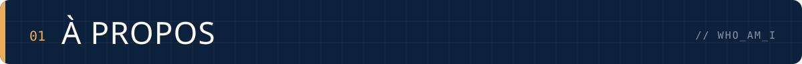
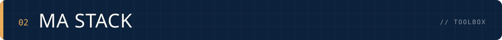
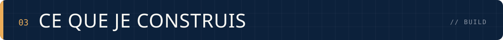
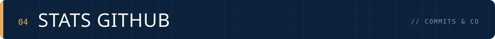
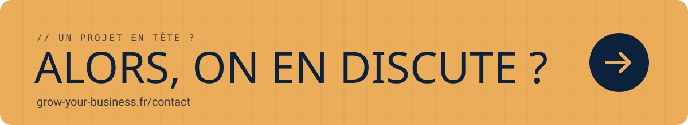

<div align="center">
  <a href="https://grow-your-business.fr/">
    
  </a>

  <br />

  <p><a href="https://grow-your-business.fr/"></a> <a href="mailto:gwenael.klock@grow-your-business.fr"></a> </p>
</div>

<br />



```ts
const gwenael = {
  role:      "Développeur web & mobile",
  agence:    "Grow Your Business — agence tech & digitale, IA native",
  focus:     ["Applications métiers", "Apps mobiles", "Architecture propre"],
  devise:    "De la collaboration au progrès.",
  contact:   "gwenael.klock@grow-your-business.fr",
};
```

- 🚀 Je conçois et fais évoluer des **applications web & mobile** chez [Grow Your Business](https://grow-your-business.fr/)
- 🧱 J'aime le code bien rangé : **Clean Architecture**, typage strict, tests
- 📱 Du **front Nuxt / Next** au **back NestJS**, en passant par le **mobile React Native**
- 💬 Un projet ? → [grow-your-business.fr/contact](https://grow-your-business.fr/contact)

<br />



<table>
  <tr>
    <td width="150"><b><code>// FRONT</code></b></td>
    <td>
      
      
      
      
      
      
      
      
    </td>
  </tr>
  <tr>
    <td><b><code>// MOBILE</code></b></td>
    <td>
      
      
    </td>
  </tr>
  <tr>
    <td><b><code>// BACK</code></b></td>
    <td>
      
      
      
      
      
    </td>
  </tr>
  <tr>
    <td><b><code>// OUTILS</code></b></td>
    <td>
      
      
      
      
    </td>
  </tr>
</table>

<br />



<table>
  <tr>
    <td width="33%" valign="top">
      <h3>🖥️ Plateformes métiers</h3>
      Back-offices et outils internes en <b>NestJS + Nuxt</b>, avec une architecture hexagonale qui tient la route.
    </td>
    <td width="33%" valign="top">
      <h3>📱 Apps mobiles</h3>
      Applications <b>React Native / Expo</b> pour iOS et Android, de la maquette à la publication.
    </td>
    <td width="33%" valign="top">
      <h3>⚡ Sites & web apps</h3>
      Sites vitrines et produits web en <b>Next.js + Tailwind</b>, rapides et bien référencés.
    </td>
  </tr>
</table>

<br />



<div align="center">
  
  
</div>

<br />

<a href="https://grow-your-business.fr/contact">
  
</a>

<div align="center">
  <sub><code>// De la collaboration au progrès.</code></sub>
</div>
